<!-- readme-standard: 2026-11-02 -->

# 💻 PIR® Tech Committee (TechCom)

*Volunteers keeping the websites, email, forms, Zoom, calendars, Discord and GitHub running.*

 **You are here:** PIR® › source `tech-committee` (private) → twin `tech-committee-public` (public, listed paths only) · `main` is the working branch

##  TL;DR

1.  **What this is.** How PIR®'s websites and tools are put together, written so the next volunteer can pick it up, and an archive of every page on both WordPress sites.
2.  **Who it is for.** Anyone who needs tech help, and anyone who wants to serve. Writing, testing, organizing and asking good questions all count.
3.  **Do this first.** Need help? Type `/techcom` in [PIR®'s Discord](https://discord.gg/MyprTq8w95) or use the [web helpdesk](https://psychedelicsinrecovery.github.io/alex-desk-public/portal.html).

> 🌐 [Tech Committee page](https://service.psychedelicsinrecovery.org/tech-committee/) · 🎫 Need tech help? Type `/techcom`
> in [PIR®'s Discord](https://discord.gg/MyprTq8w95) or use the [web helpdesk](https://psychedelicsinrecovery.github.io/alex-desk-public/portal.html)

The **Tech Committee** of **Psychedelics In Recovery™ (PIR®)** keeps the fellowship's technology running: the
websites, email, forms, Zoom and calendars, the Discord server and its helpers (like **A.L.E.X.**), and PIR®'s
GitHub organization. We're volunteers, and **no coding is needed to serve**: writing, testing, organizing and
asking good questions all count.

## 📚 What's public here

| Folder / file | What it is |
|---|---|
| [`docs/public/`](docs/public/) | How PIR®'s websites and tools are put together, written so the next volunteer can pick it up |
| ↳ [`DISCORD-APPS-AND-INTEGRATIONS.md`](docs/public/DISCORD-APPS-AND-INTEGRATIONS.md) | Every bot and app in PIR®'s Discord: what it does, what it can see, what it keeps |
| ↳ [`DISCORD-PERSONAS.md`](docs/public/DISCORD-PERSONAS.md) | The names and voices of our helpers: A.L.E.X., C.A.T.A.L.Y.S.T., C.A.R.L., D.Y.N.O. and friends |
| ↳ `CAPABILITIES-*`, `*-FIX.md`, `*-RECONNAISSANCE.md` | WordPress / Elementor notes: what the site builder can do, and fixes we've made |
| [`wordpress-crawls/`](wordpress-crawls/) | A Markdown archive of every page on psychedelicsinrecovery.org and the service site. It's also the knowledge A.L.E.X. answers from. |

## 🧭 TechCom at a glance
- 🎫 **Helpdesks:** `/techcom` for the websites, email, forms, Zoom and calendar; `/github` for PIR®'s GitHub.
  Portals: [TechCom desk](https://psychedelicsinrecovery.github.io/techcom-desk-public/) ·
  [GitHubDesk](https://psychedelicsinrecovery.github.io/github-desk-public/)
- 🌌 **A.L.E.X.**, PIR®'s helper: https://psychedelicsinrecovery.github.io/alex-desk-public/ (with its
  [roadmap](https://psychedelicsinrecovery.github.io/alex-desk-public/roadmap.html) and
  [sustainability](https://psychedelicsinrecovery.github.io/alex-desk-public/sustainability.html) pages)
- 🛡️ **Subcommittee:** Privacy Policy & Data Stewardship, which keeps the
  [privacy policy](https://www.psychedelicsinrecovery.org/safety-and-ethics/privacy-policy/) honest and current
- 📇 **Who's who:** [CONTACTS.md](https://github.com/psychedelicsinrecovery/.github/blob/main/CONTACTS.md)

## 🙋 Join us
Say hello in the 🖥️tech-com channel of PIR®'s Discord, or open a `/techcom` ticket that says "I'd like to serve".
We'll find something that fits your time and skills.

## 🗄️ The private side
This public repository is a filtered copy of TechCom's private working repo, published automatically by an
allowlist (only `README.md`, its pictures in `assets/`, `docs/` minus `docs/private/`, and `wordpress-crawls/`). Proposals, briefs, minutes,
Discord operations and anything with personal details stay private. Committee members can request access with a
`/github` ticket.

##  Suggest a change

Noticed something? Type `/techcom` in [PIR®'s Discord](https://discord.gg/MyprTq8w95) or use the [web helpdesk](https://psychedelicsinrecovery.github.io/alex-desk-public/portal.html); TechCom reads it. Committee members with access may send a pull request against `main` here, and a person with the role merges; the public mirror takes none.

## 📄 License
- 💻 **Code:** MIT, see [`LICENSE`](LICENSE)
- 📝 **Written content** (docs, changelog and library prose, READMEs): CC BY-SA 4.0, see [`LICENSE-CONTENT`](LICENSE-CONTENT)
- 🏷️ **Names, logos and marks:** not covered by either license, see [`TRADEMARKS.md`](TRADEMARKS.md)

PIR® and Psychedelics In Recovery™ are marks of Psychedelics In Recovery, a 501(c)(3) nonprofit.

The front door follows the living [README standard](https://github.com/drasticstatic/my-template/blob/main/README-STANDARD.md). Copy it, improve it.
